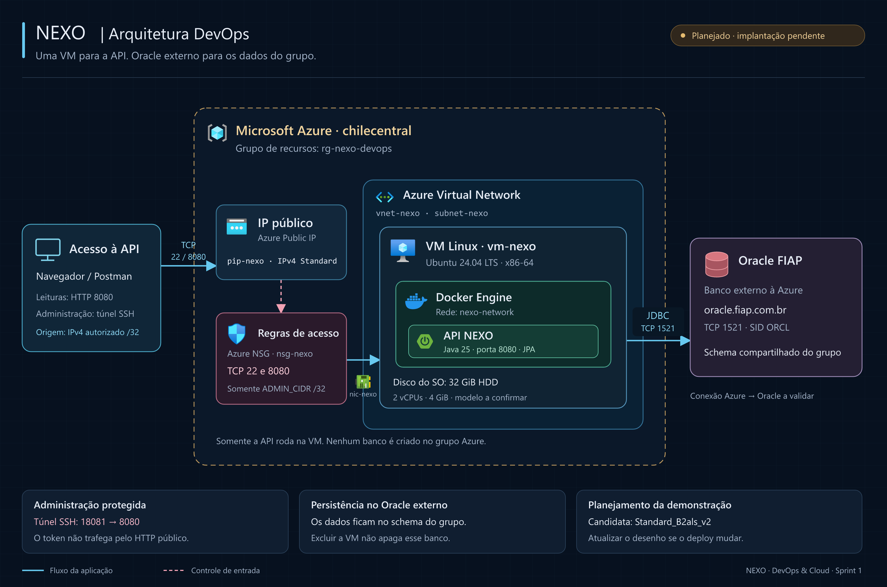

# Arquitetura DevOps do NEXO

A API NEXO será executada em um container Docker dentro de uma VM Linux no Azure. O Oracle permanece no servidor da FIAP, com o schema compartilhado do grupo. Essa separação permite remover os recursos da demonstração sem excluir os dados do projeto.

O desenho representa a arquitetura prevista nos scripts, com a primeira tentativa na região `chilecentral`. A VM ainda não foi provisionada, e a conexão Azure → Oracle continua pendente de validação.

## Diagrama

- [Abrir a imagem PNG](diagrama-arquitetura.png)

O diagrama em PNG inclui os ícones e os nomes dos serviços Azure e é utilizado no README, no vídeo e no PDF.

## Componentes

| Componente | Papel na solução |
| --- | --- |
| Navegador ou Postman | Consulta a API a partir do IPv4 administrativo autorizado |
| Azure Public IP, `pip-nexo` | Fornece o endereço público da VM para a demonstração |
| Azure Network Security Group, `nsg-nexo` | Permite entrada TCP 22 e 8080 somente de `ADMIN_CIDR`, com máscara `/32` |
| Azure Virtual Network, `vnet-nexo` | Organiza a rede da VM; a interface utiliza `subnet-nexo` |
| Azure Network Interface, `nic-nexo` | Conecta a VM à subnet, ao IP público e ao NSG |
| Azure Virtual Machines, `vm-nexo` | Hospeda Ubuntu 24.04 LTS x86-64 e Docker |
| Docker Engine e `nexo-network` | Executam o container da API em uma rede bridge nomeada |
| API NEXO | Usa Java 25, Spring Boot e JPA, com porta interna 8080 e usuário sem privilégios administrativos |
| Oracle FIAP | Mantém as tabelas e os dados do grupo fora da VM Azure |

A candidata é `Standard_B2als_v2`, com 2 vCPUs e 4 GiB de RAM, mais barata que a candidata Intel equivalente entre os preços comparados na região. O disco de sistema previsto tem 32 GiB e usa Standard HDD LRS para reduzir o custo da demonstração. A disponibilidade do modelo ainda precisa ser confirmada; não há troca automática por uma VM mais cara.

## Como os componentes se comunicam

As consultas públicas chegam ao IP da VM pela porta 8080. O NSG limita a origem dessas conexões ao endereço administrativo configurado. No desenho, ele aparece no caminho para destacar esse controle, mas não é um servidor intermediário: suas regras são aplicadas à interface de rede.

O Docker encaminha a porta publicada para a porta 8080 do container. A API usa a URL JDBC para acessar `oracle.fiap.com.br:1521`, com SID `ORCL` e as credenciais autorizadas. Nenhum serviço de banco é criado no Azure ou no Compose.

A administração usa SSH na porta 22. Para enviar o token da API, o acesso passa por um túnel SSH: a porta local 18081 encaminha as requisições à porta 8080 da VM. Essa porta local não é uma segunda implantação. A consulta ao IP público e a visualização do container pelo terminal SSH comprovam onde a aplicação está executando.

O projeto não configura HTTPS público nesta etapa. Por isso, o token não deve ser enviado pelo endereço HTTP público. A porta 1521 do Oracle não é liberada como entrada na VM; ela é o destino externo da conexão JDBC.

## Persistência e exclusão

O disco mostrado pertence ao sistema operacional da VM, não ao Oracle. O Compose não cria um volume de banco. Os dados continuam no schema FIAP mesmo depois que o container, a VM e o grupo de recursos forem excluídos.

Isso não substitui uma política de backup do banco. A exclusão remove os arquivos que estiverem na VM, então as evidências da entrega precisam ser copiadas antes da limpeza.

O script configura a exclusão do disco de sistema, da NIC e do IP público associado junto à VM. A limpeza final remove todo o grupo de recursos, incluindo VNet e NSG, e só confirma sucesso após verificar que o grupo está ausente e a consulta de recursos restantes está vazia.

## Atualização para a gravação

Depois de validar a implantação, conferir os nomes, a região, o modelo da VM e as portas efetivamente usados. Só então substituir a indicação de implantação pendente pela identificação da arquitetura demonstrada. Se o deploy mudar, atualizar o desenho e os guias antes de gravar.

Os parâmetros estão em [azure.env.example](../azure.env.example), e os comandos de implantação estão no [guia Azure](azure.md).

## Ícones e formatos

Os ícones Azure vieram da [coleção oficial do Azure Architecture Center](https://learn.microsoft.com/en-us/azure/architecture/icons/), pacote `Azure_Public_Service_Icons_V24.zip`. Eles são usados com os nomes dos serviços, sem recorte, rotação ou mudança de proporção.

Os símbolos Docker e Spring Boot vieram do projeto [Simple Icons](https://github.com/simple-icons/simple-icons). As marcas identificam as tecnologias utilizadas; o NEXO não é um serviço oficial dessas empresas.

O PNG incorpora os ícones, pode ser aberto sem acesso à internet e está em alta resolução para uso em gravações e documentos.
