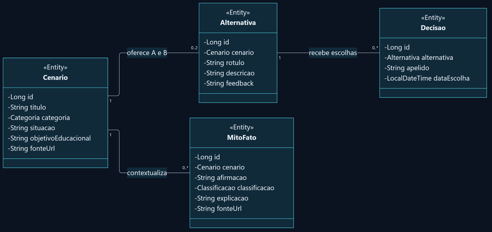
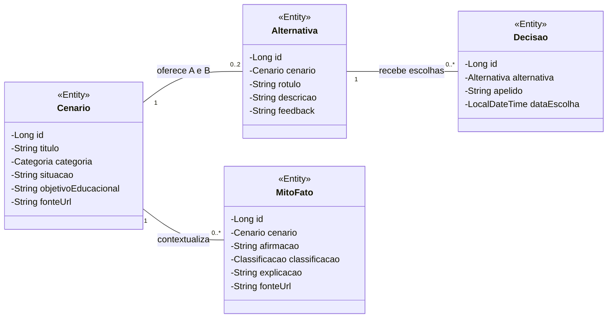

# Modelagem Java — NEXO

**Java Advanced · Sprint 1 · Modelo de domínio e persistência JPA**

O NEXO organiza uma experiência educativa sobre aplicações civis da tecnologia nuclear: o participante conhece um cenário, compara alternativas, registra uma decisão e consulta uma explicação de mito ou fato.

Esta modelagem descreve as classes e as regras implementadas na API. Não propõe entidades futuras nem substitui os modelos e a notação exigidos na entrega de Database.

## Visão geral

**Formatos:** [apresentação visual offline](modelagem.html) · [SVG vetorial](modelo-dominio.svg) · [PNG em alta resolução](modelo-dominio.png) · [fonte Mermaid editável](modelo-dominio.mmd).

As classes exibem os atributos privados de domínio. Construtores, métodos de atualização e getters foram omitidos para facilitar a leitura. As associações representam vínculos do modelo; não significam que a classe pai declare uma coleção Java. No código, a navegação persistente está nas referências `@ManyToOne` das classes filhas.

## Responsabilidade de cada entidade

| Entidade | Responsabilidade | Persistência |
| --- | --- | --- |
| **Cenario** | Define o contexto, a categoria, a situação, o objetivo educacional e a fonte. | `NEXO_CENARIO` |
| **Alternativa** | Representa uma das escolhas A/B e seu feedback educativo, sempre ligada a um cenário. | `NEXO_ALTERNATIVA` |
| **Decisao** | Registra uma escolha fictícia por apelido, com a data/hora gerada pelo Oracle. | `NEXO_DECISAO` |
| **MitoFato** | Apresenta uma afirmação, sua classificação, explicação e fonte, ligada ao cenário. | `NEXO_MITO_FATO` |

## Relacionamentos e cardinalidades

| Relação | Cardinalidade | Significado |
| --- | --- | --- |
| Cenario → Alternativa | **1 : 0..2** | Um cenário em montagem pode ter zero, uma ou duas alternativas. Cada alternativa pertence a exatamente um cenário. |
| Alternativa → Decisao | **1 : 0..*** | Uma alternativa pode receber nenhuma ou várias decisões. Cada decisão referencia exatamente uma alternativa. |
| Cenario → MitoFato | **1 : 0..*** | Um cenário pode ter nenhum ou vários itens de mito/fato. Cada item pertence a exatamente um cenário. |

O limite de duas alternativas resulta dos rótulos permitidos **A/B** e da unicidade de **cenário + rótulo**. Na camada JPA, a associação da alternativa é `@ManyToOne`; a restrição A/B complementa essa associação.

**Cenário apto para o jogo:** a consulta `GET /cenarios/{id}/jogo` exige **as duas alternativas A e B e pelo menos um MitoFato**. Enquanto isso não estiver completo, o CRUD permite a montagem gradual e a consulta do jogo retorna `409`.

## Tipos enumerados

| Enum Java | Valores | Utilização |
| --- | --- | --- |
| `Categoria` | `SAUDE`, `AGRICULTURA`, `INDUSTRIA`, `PESQUISA`, `ENERGIA` | `Cenario.categoria` |
| `Classificacao` | `MITO`, `FATO` | `MitoFato.classificacao` |

Os dois enums são persistidos como texto com `EnumType.STRING`; não são tabelas adicionais. `Alternativa.rotulo` é uma `String` validada para A/B, não um enum Java.

## Atributos e limites da API

Os identificadores são `Long`, gerados por sequence. Os demais campos abaixo são obrigatórios nas requisições de criação/substituição; recebem as validações próprias de cada DTO.

| Classe | Atributos de conteúdo | Referência obrigatória |
| --- | --- | --- |
| `Cenario` | `titulo` até 150; `categoria`; `situacao` até 1000; `objetivoEducacional` até 500; `fonteUrl` até 1000 caracteres. | — |
| `Alternativa` | `rotulo` A/B; `descricao` e `feedback` até 1000 caracteres. | `Cenario cenario` |
| `Decisao` | `apelido` de 3 a 50 caracteres. `dataEscolha` é `LocalDateTime`, preenchida pelo banco, não pelo cliente. | `Alternativa alternativa` |
| `MitoFato` | `afirmacao` até 500; `classificacao`; `explicacao` e `fonteUrl` até 1000 caracteres. | `Cenario cenario` |

As referências entram na API por IDs nos DTOs e são resolvidas para entidades pelos serviços. Os campos `fonteUrl` aceitam URLs HTTP/HTTPS validadas. Textos de entrada passam por `trim`.

## Regras de integridade

1. **IDs gerados:** as quatro entidades usam `GenerationType.SEQUENCE` e `allocationSize = 1`. O cliente não determina os IDs.
2. **Vínculos obrigatórios:** alternativa e mito/fato precisam de um cenário existente; decisão precisa de uma alternativa existente. Referência inexistente resulta em `404`.
3. **Alternativas únicas:** não pode haver duas alternativas com o mesmo rótulo no mesmo cenário. A API e as constraints do Oracle protegem o contrato.
4. **Data preservada:** `Decisao.dataEscolha` vem de `DEFAULT LOCALTIMESTAMP`, é recuperada no INSERT e não é alterada no PUT. Representa data/hora local, sem offset ou conversão automática para UTC.
5. **Exclusão sem cascata:** remover registros dependentes antes do registro pai. Dependências e violações de integridade são tratadas como `409`, sem expor detalhes SQL ao cliente.
6. **Descoberta por cenário:** os itens de mito/fato pertencem ao cenário e podem ser consultados independentemente da alternativa A/B escolhida.
7. **Sem conta individual:** apelido não representa identidade autenticada. Não existem entidades de usuário, sessão, ranking ou login no modelo atual.

## Da requisição à persistência

| Camada | Papel na implementação |
| --- | --- |
| **Controller + DTO** | Recebem o contrato HTTP, aplicam Bean Validation e documentam entradas e respostas no OpenAPI. |
| **Service** | Resolve referências, aplica regras de negócio e delimita transações. |
| **Repository** | Usa Spring Data `JpaRepository` para CRUD e Query Methods para consultas. |
| **Entidade JPA + Oracle** | Mapeia tabelas, referências, enums, sequences e a data gerada pelo banco. |

As entidades não são expostas diretamente nas respostas HTTP. A API usa DTOs de resposta e não depende de procedures ou functions para executar o CRUD.

## Referências da implementação

- Classes: [Cenario](../../src/main/java/br/com/fiap/nexo/cenario/Cenario.java), [Alternativa](../../src/main/java/br/com/fiap/nexo/alternativa/Alternativa.java), [Decisao](../../src/main/java/br/com/fiap/nexo/decisao/Decisao.java) e [MitoFato](../../src/main/java/br/com/fiap/nexo/mitofato/MitoFato.java).
- Enums: [Categoria](../../src/main/java/br/com/fiap/nexo/cenario/Categoria.java) e [Classificacao](../../src/main/java/br/com/fiap/nexo/mitofato/Classificacao.java).
- [Estrutura Oracle](sql/schema-oracle.sql) · [Executar a API](../../README.md#executar-a-api) · [Dados para teste](../../README.md#dados-para-teste).
- [README do projeto](../../README.md).

## Diagrama Mermaid

A fonte completa, incluindo o tema visual, está em [`modelo-dominio.mmd`](modelo-dominio.mmd). A versão abaixo também pode ser renderizada diretamente no GitHub.

